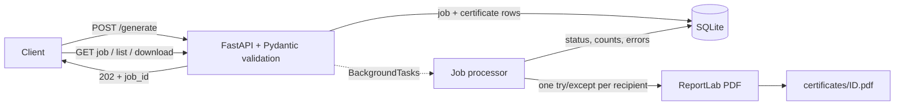

# Bulk Certificate Generator

Asynchronous backend API that turns a list of recipients into personalised PDF certificates
(one predefined template), tracks progress per job and per certificate, and lets the client
download the results. A failure on one certificate never blocks the others.




**Stack:** Python 3.10+, FastAPI, Pydantic v2, SQLAlchemy 2 + SQLite, ReportLab, pytest.

## Setup

```bash
python -m venv .venv
source .venv/bin/activate          # Windows: .venv\Scripts\activate
pip install -r requirements-dev.txt
```

## Run the application

```bash
uvicorn app.main:app --reload
```

Interactive API docs: http://127.0.0.1:8000/docs. The SQLite file (`certificates.db`) and the
`certificates/` folder are created automatically on startup.

Optional environment variables: `DATABASE_URL`, `CERT_DIR`, `MAX_RECIPIENTS` (default 500).

## Run tests and lint

```bash
pytest                      # 29 tests, ~99% line coverage
ruff check . && ruff format --check .
```

## API

| Method | Path | Purpose |
|---|---|---|
| POST | `/api/certificates/generate` | Submit a bulk request. Returns `202` + `job_id` |
| GET | `/api/jobs/{job_id}` | Status, progress counts, list of failures |
| GET | `/api/jobs/{job_id}/certificates` | Per-recipient status and download links |
| GET | `/api/certificates/{certificate_id}` | Download the PDF |

### Submit a request

```bash
curl -X POST http://127.0.0.1:8000/api/certificates/generate \
  -H "Content-Type: application/json" \
  -d '{"recipients": [
        {"name": "Alice Johnson", "email": "alice@example.com", "course": "Cybersecurity 101"},
        {"name": "Bob Smith", "email": "bob@example.com", "course": "Cybersecurity 101",
         "completion_date": "2026-10-01"}
      ]}'
# {"job_id": "…", "status": "PENDING", "total_recipients": 2}
```

`completion_date` is optional (defaults to today).

### Check progress, then retrieve certificates

```bash
curl http://127.0.0.1:8000/api/jobs/<job_id>
curl http://127.0.0.1:8000/api/jobs/<job_id>/certificates
curl -o alice.pdf http://127.0.0.1:8000/api/certificates/<certificate_id>
```

Job statuses: `PENDING` -> `PROCESSING` -> `COMPLETED` | `PARTIAL_SUCCESS` | `FAILED`.
`processed_count = successful_count + failed_count`, so progress is `processed_count / total_recipients`.

## Design decisions

- **Background processing (FastAPI `BackgroundTasks`).** A request can contain hundreds of
  recipients, so the API stores the job and returns `202 Accepted` immediately; the client polls
  the job endpoint. This avoids long HTTP requests/timeouts without extra infrastructure.
  Trade-off: if the server process restarts mid-job, that job is not resumed. A task queue
  (Celery/RQ) would fix that but is out of scope here.
- **Validation up front, all-or-nothing.** The whole payload is validated by Pydantic before any
  job exists (name/course non-blank, valid email, 1..500 recipients). An invalid payload returns
  `422` and creates nothing. Failures during *generation* are a different case (below).
- **Failure isolation.** Each certificate is generated inside its own `try/except`; a failure is
  stored on that certificate (`status=FAILED`, `error_message`) and the loop continues. Final job
  status: all ok -> `COMPLETED`, some failed -> `PARTIAL_SUCCESS`, none ok -> `FAILED`.
- **Two tables.** `generation_jobs` (status + counters) and `certificates` (one row per recipient:
  status, file path, error). Counters are committed after every certificate so progress is live.
- **One template, one function.** `generate_certificate(cert, out_dir)` renders one PDF with
  ReportLab; long names/courses auto-shrink to fit.
- **Duplicates allowed.** The same email twice yields two independent certificates.
- **Storage.** PDFs are saved as `certificates/<certificate_id>.pdf`; the DB stores the path.

## Assumptions / limitations

- Built-in PDF font (Helvetica) covers Latin characters; non-Latin scripts would need a TTF font
  registered in ReportLab.
- No authentication (not required by the assignment).
- SQLite is used for simplicity. The SQLite-only `check_same_thread` option is applied only for
  SQLite URLs, so pointing `DATABASE_URL` at PostgreSQL needs just the driver installed
  (not tested here).
- Jobs run inside the web process; a restart mid-job leaves that job in `PROCESSING`.
  A task queue (Celery/RQ) with a recovery step would be the production answer.
- PDFs are written to a temp file and renamed on success, so a crash never leaves a partial
  certificate. If the DB commit fails after a PDF is written, the file is removed.
- If the processor itself crashes (not a single certificate), the job is marked `FAILED` with
  `completed_at` set; per-certificate results already committed are kept.

## Project structure

```
app/
  main.py                 app + startup (creates tables)
  config.py               env-based settings
  database.py             engine, session, get_db
  models.py               GenerationJob, Certificate
  schemas.py              Pydantic request/response models
  api/certificates.py     the 4 endpoints
  services/certificate_generator.py   one PDF per recipient
  services/job_processor.py           loop + failure isolation + status
tests/                    pytest suite (29 tests)
```
