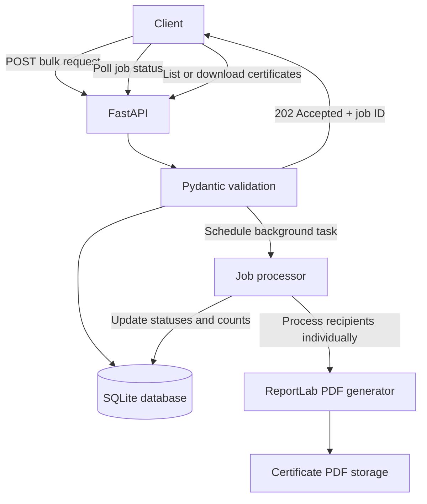

# Bulk Certificate Generator


A FastAPI backend service for generating personalized PDF certificates in bulk. It validates recipient data, tracks each generation job, isolates individual certificate failures, and provides API endpoints to monitor progress and retrieve generated PDFs.

The service uses a predefined certificate template and processes each recipient independently, so a failure affecting one certificate does not prevent the remaining recipients from being processed.

## Features

- **Bulk generation:** Submit up to 500 recipients in a single request.
- **Request validation:** Validate recipient details before creating a generation job.
- **Background processing:** Return `202 Accepted` with a job ID while certificate generation runs in the background.
- **PDF generation:** Generate personalized PDF certificates using ReportLab.
- **Job tracking:** Monitor job status, successful and failed counts, and processing progress.
- **Failure isolation:** Record individual certificate failures and continue processing the remaining recipients.
- **Certificate retrieval:** Download successfully generated PDFs through the API.
- **Persistent metadata:** Store job and certificate records in a relational database.
- **Automated quality checks:** Run tests, coverage reporting, linting, and formatting checks through GitHub Actions.

## Architecture



### Technology stack

| Component | Technology |
|---|---|
| Language | Python 3.10+ |
| Backend framework | FastAPI |
| Data validation | Pydantic v2 |
| ORM | SQLAlchemy 2.x |
| Database | SQLite |
| PDF generation | ReportLab |
| Testing | pytest, FastAPI TestClient |
| Coverage | pytest-cov |
| Code quality | Ruff |
| Continuous integration | GitHub Actions |

## Getting started

### Prerequisites

- Python 3.10 or later
- pip
- Git (optional, for cloning the repository)

### 1. Clone the repository

```bash
git clone https://github.com/shruthakeerthana/bulk-certificate-generator.git
cd bulk-certificate-generator
```

### 2. Create a virtual environment

```bash
python -m venv .venv
```

Activate it using the appropriate command.

**Windows PowerShell:**

```powershell
.\.venv\Scripts\Activate.ps1
```

**macOS/Linux:**

```bash
source .venv/bin/activate
```

### 3. Install dependencies

```bash
python -m pip install -r requirements-dev.txt
```

### 4. Start the application

```bash
uvicorn app.main:app --reload
```

The API will be available at:

- **Interactive Swagger documentation:** http://127.0.0.1:8000/docs
- **ReDoc documentation:** http://127.0.0.1:8000/redoc

On startup, the application creates the database tables and certificate storage directory when they do not already exist.

## API reference

All endpoints are prefixed with `/api`.

| Method | Endpoint | Description |
|---|---|---|
| `POST` | `/api/certificates/generate` | Submit a bulk certificate-generation job |
| `GET` | `/api/jobs/{job_id}` | Retrieve job status, progress, and failures |
| `GET` | `/api/jobs/{job_id}/certificates` | List the certificates associated with a job |
| `GET` | `/api/certificates/{certificate_id}` | Download a successfully generated PDF |

### 1. Submit a generation job

**Request**

`POST /api/certificates/generate`

Example JSON body:

```json
{
  "recipients": [
    {
      "name": "Alice Johnson",
      "email": "alice@example.com",
      "course": "Cybersecurity 101",
      "completion_date": "2026-10-01"
    },
    {
      "name": "Bob Smith",
      "email": "bob@example.com",
      "course": "Cybersecurity 101",
      "completion_date": "2026-10-01"
    }
  ]
}
```

The `completion_date` field is optional and defaults to the current date if omitted.

**Successful response — `202 Accepted`**

```json
{
  "job_id": "<job_id>",
  "status": "PENDING",
  "total_recipients": 2
}
```

The returned job ID is used to monitor processing and retrieve the generated certificates.

### 2. Check job progress

**Request**

`GET /api/jobs/{job_id}`

Example response after successful processing:

```json
{
  "job_id": "<job_id>",
  "status": "COMPLETED",
  "total_recipients": 2,
  "successful_count": 2,
  "failed_count": 0,
  "processed_count": 2
}
```

The response also includes timestamps and failure details where applicable.

Progress is calculated as:

`processed_count = successful_count + failed_count`

### 3. List certificates for a job

**Request**

`GET /api/jobs/{job_id}/certificates`

This endpoint returns the certificate records associated with a job, including each recipient's status and the download link when a certificate was generated successfully.

### 4. Download a certificate

**Request**

`GET /api/certificates/{certificate_id}`

A successful request returns the generated PDF.

The API returns an appropriate error if the certificate does not exist, its file is missing, or generation did not succeed.

### Error handling

| HTTP status | Meaning |
|---|---|
| `202 Accepted` | Generation job accepted |
| `200 OK` | Job information or certificate list returned successfully |
| `404 Not Found` | Job, certificate, or required PDF file not found |
| `409 Conflict` | Certificate is not available for download |
| `422 Unprocessable Entity` | Request validation failed |

## Job lifecycle and failure handling

A job transitions through the following states:

```text
PENDING
   |
   v
PROCESSING
   |
   +------> COMPLETED
   |
   +------> PARTIAL_SUCCESS
   |
   +------> FAILED
```

- **COMPLETED:** Every certificate was generated successfully.
- **PARTIAL_SUCCESS:** At least one certificate succeeded and at least one failed.
- **FAILED:** No certificates were generated successfully, or an unexpected job-level failure occurred.

Every recipient is processed independently. A generation error is recorded against the affected certificate, and processing continues for the remaining recipients.

Input validation is performed before the job is created. Invalid request data results in a validation response rather than a partially created batch.

## Configuration

The following environment variables can be used to configure the application:

| Variable | Purpose | Default |
|---|---|---|
| `DATABASE_URL` | SQLAlchemy database connection URL | SQLite database |
| `CERT_DIR` | Directory for generated certificate PDFs | `certificates/` |
| `MAX_RECIPIENTS` | Maximum recipients accepted in one request | `500` |

SQLite is the default and tested database configuration. PostgreSQL compatibility has not been independently verified for this project.

## Running tests

Install development dependencies as described above, then run the complete test suite with coverage:

```bash
pytest --cov=app --cov-report=term-missing
```

Run Ruff lint checks:

```bash
ruff check .
```

Verify formatting:

```bash
ruff format --check .
```

The latest local verification completed with **30 tests passing and 99% line coverage**. Coverage can vary if the implementation or test suite changes.

GitHub Actions automatically runs linting, formatting checks, and the test suite with coverage on pushes and pull requests.

## Project structure

```text
bulk-certificate-generator/
├── .github/
│   └── workflows/
│       └── tests.yml
├── app/
│   ├── api/
│   │   └── certificates.py
│   ├── services/
│   │   ├── certificate_generator.py
│   │   └── job_processor.py
│   ├── config.py
│   ├── database.py
│   ├── main.py
│   ├── models.py
│   └── schemas.py
├── certificates/
│   └── .gitkeep
├── tests/
│   ├── conftest.py
│   ├── test_api.py
│   ├── test_certificate_generator.py
│   └── test_job_processor.py
├── .gitignore
├── pyproject.toml
├── requirements-dev.txt
├── requirements.txt
└── README.md
```

## Design decisions and trade-offs

### Background processing

FastAPI `BackgroundTasks` allows the request handler to return `202 Accepted` without waiting for the entire batch to finish. Clients can poll the job endpoint for progress.

The background task executes within the application process. If the process terminates unexpectedly, an unfinished job is not automatically resumed. A durable task queue and recovery mechanism would be appropriate for a production workload requiring reliable job recovery.

### Database design

Two related tables are used:

- `generation_jobs`: stores job status, counters, and timestamps.
- `certificates`: stores recipient information, individual status, generated file path, and failure details.

SQLAlchemy provides the ORM layer, while SQLite keeps local setup simple.

### Certificate generation

A single ReportLab function generates the predefined certificate design, inserting the relevant recipient and course information. Text is fitted to the available space to handle longer names and course titles.

### File safety

PDFs are written to temporary files and renamed to their final `.pdf` paths only after generation succeeds. This prevents an incomplete PDF from appearing under the final certificate filename. Temporary-file cleanup is attempted when generation fails; an abrupt process termination can still leave a temporary file behind.

### Validation and failure isolation

The request is validated as a whole before a job is created. Once processing begins, each certificate is handled independently so one generation failure does not stop the batch.

### Scope

The implementation intentionally uses one certificate template, SQLite, and in-process background processing. Authentication, template editing, distributed workers, and automatic recovery after process restarts are outside the current assignment scope.

## Assumptions and limitations

- The certificate design uses ReportLab's built-in Helvetica font. Full support for non-Latin scripts requires a suitable Unicode TrueType font.
- Authentication is not implemented because it is not required for the assignment.
- Generated PDFs are stored on the local filesystem.
- Background jobs are not durable across unexpected process termination.
- PostgreSQL operation has not been independently tested.
- The implementation is scoped to the assignment and does not include distributed job orchestration or automatic recovery.

## License

No license has been specified for this repository.
